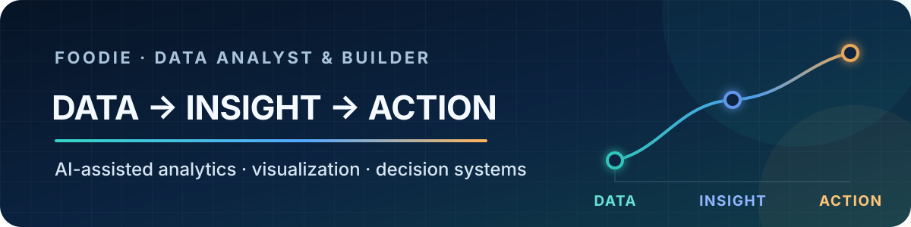
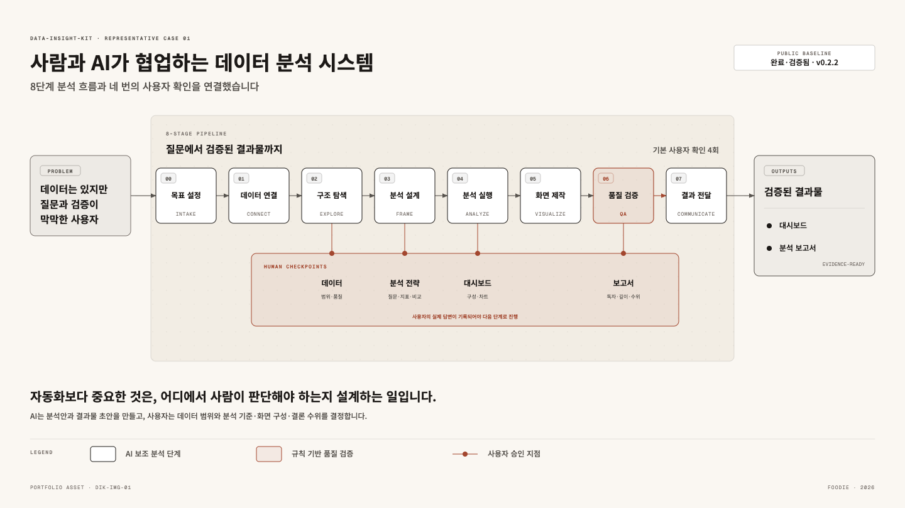
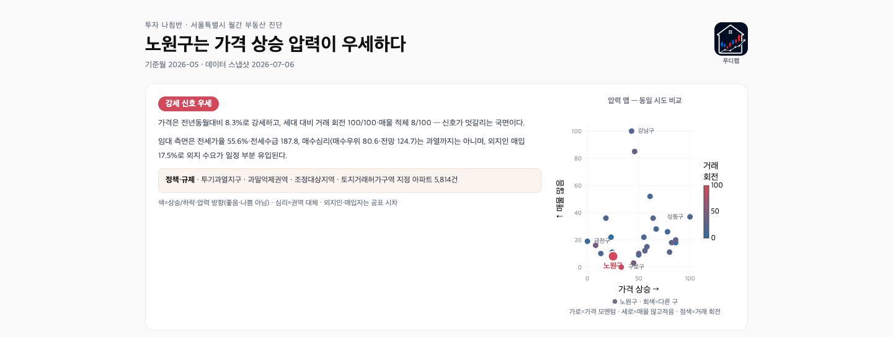
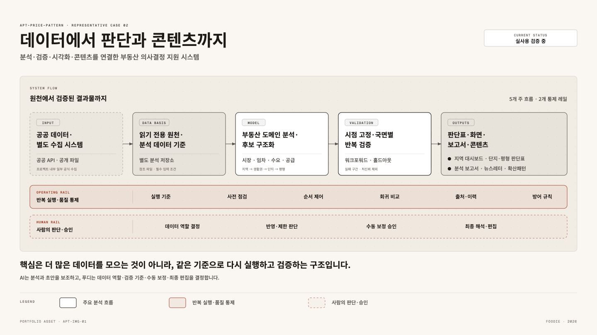
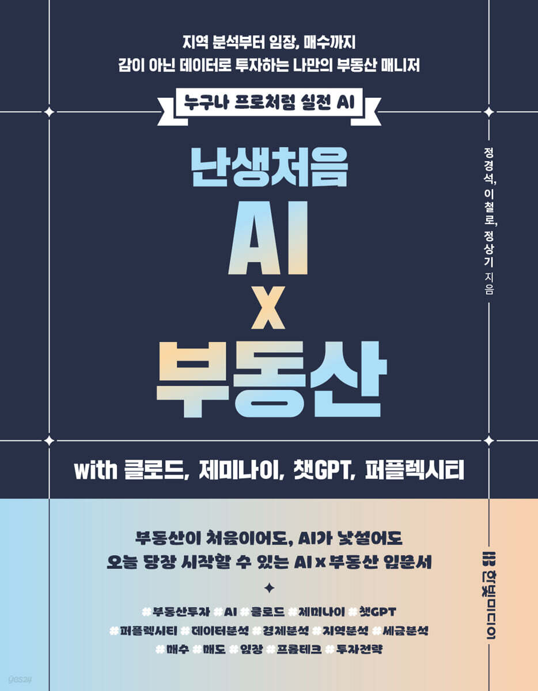

<p align="center">
  
</p>

<p align="center">
  <strong>데이터를 분석해, 사람이 결정할 수 있는 형태로 만듭니다.</strong><br />
  <sub>AI-assisted analytics · visualization · decision systems</sub>
</p>

<p align="center">
  <a href="https://foodie-repository.github.io/"><strong>포트폴리오와 아티클 보기 →</strong></a>
</p>

---

# 실제 문제를 분석하고, 더 나은 의사결정을 돕습니다.

## 안녕하세요. 푸디입니다.

저는 **데이터 분석가**이자, AI와 함께 일하는 분석 워크플로를 설계하는 빌더입니다.
복잡한 데이터를 설명 가능한 분석으로 바꾸고, 그 결과가 보고서·대시보드·학습 도구로
이어지도록 만드는 일을 좋아합니다.

현재는 다음 주제에 집중하고 있습니다.

- **AI 기반 데이터 분석 운영체계** — 질문, 검증, 분석, 시각화, 보고를 하나의 흐름으로 연결합니다.
- **의사결정을 돕는 시각화** — 보기 좋은 차트보다 무엇을 판단해야 하는지가 드러나는 화면을 만듭니다.
- **부동산 데이터 인텔리전스** — 거래·가격·입지 데이터를 재현 가능한 분석 도구로 바꿉니다.
- **주식 데이터 인텔리전스** — 시장·공시·재무 데이터를 근거 중심의 투자 의사결정 도구로 바꿉니다.

## 제가 하는 일

- **프로젝트·컨설팅**<br />
  업무 문제를 진단하고 데이터를 분석해, 더 나은 의사결정을 돕는 프로토타입과 AI·데이터 시스템을 만듭니다.

- **교육·콘텐츠**<br />
  분석과 구현 경험을 강의·책·교육 콘텐츠로 정리해, 다른 사람이 이해하고 직접 활용할 수 있도록 전달합니다.

## 최근 아티클

### [AI 에이전트는 어디까지 맡기고, 어디에서 사람이 판단해야 할까](https://foodie-repository.github.io/articles/agent-human-judgment/)

에이전트의 자율성을 모호성·영향과 가역성·검증 가능성으로 나누고, 사람이 개입해야 할 지점을 실제 운영 구조에 맞춰 정리했습니다.

[AI 기술·활용 아티클 모아 보기 →](https://foodie-repository.github.io/articles/topic/ai-technology-use/)

## 대표 사례

### 1. 사람과 AI가 협업하는 데이터 분석 시스템

- **프로젝트명:** `data-insight-kit`
- **목적:** 데이터는 있지만 질문과 검증이 막막한 사용자가 AI와 함께 분석 방향을 정하고, 검증된 결과를 만들도록 돕습니다.
- **내용:** 데이터 연결부터 결과 전달까지 8단계로 구성하고, 데이터·분석 전략·대시보드·보고서에서 사용자가 확인하도록 설계했습니다.
- **결과:** 사용자 판단을 거친 분석 보고서와 데이터 주입형 대시보드를 재현 가능한 구조로 만듭니다.

<p align="center">
  
</p>

- **역할:** 제품·파이프라인 설계, 사용자 확인 단계와 QA 체계 구현, 공개 배포
- **링크:** [Public 저장소 보기](https://github.com/foodie-repository/data-insight-kit)

### 2. 데이터에서 판단과 콘텐츠까지 연결한 부동산 분석 시스템

- **프로젝트명:** `APT-Price-Pattern`
- **목적:** 흩어진 부동산 데이터를 같은 기준으로 반복 분석해 지역 변화의 이유를 추적하고 판단 근거를 만듭니다.
- **내용:** API·크롤링 기반 데이터 수집, 데이터 계보와 분석 기준, 모델링, 반복 검증, 실행·품질 통제를 대시보드와 콘텐츠까지 연결했습니다.
- **결과:** 지역 대시보드, AI 기반 지역 분석 리포트, 패턴 라이브러리로 활용 범위를 확장했습니다.

<p align="center">
  <strong>실제 지역 대시보드</strong><br />
  <a href="./case-studies/nowon-dashboard.md">
    
  </a><br />
  <sub><a href="./case-studies/nowon-dashboard.md">노원구 대시보드 전체 구성 보기 →</a></sub>
</p>

<p align="center">
  <a href="./case-studies/real-estate-dashboard-gallery.md"><strong>부동산 분석 대시보드 모음 보기 →</strong></a><br />
  <sub>지역·단지·평형·기간을 바꾸며 가격과 거래 흐름을 탐색하는 Dash 화면을 정리했습니다.</sub>
</p>

<p align="center">
  <strong>부동산 데이터를 차트와 보고서로 확장하는 분석 에이전트 시스템</strong><br />
  <sub>같은 하네스가 데이터를 검증하고 공통·지역 특화 차트와 보고서 초안을 만든 뒤, 사람이 수치·논리·표현을 최종 검토합니다.</sub><br />
  <a href="./case-studies/dongtan-analysis-report.md">동탄구 상세 사례 보기 →</a>
</p>

<details>
  <summary><strong>분석 시스템 구조 보기</strong></summary>
  <br />
  <p align="center">
    <a href="./assets/apt-price-pattern.png">
      
    </a>
  </p>
</details>

- **역할:** 데이터 수집·계보, 분석 기준, 모델링, 검증 구조와 실행 하네스 설계
- **확장:** 지역과 기준월을 바꾸어 전국 시군구의 분석 대시보드를 같은 구조로 자동 생성할 수 있도록 설계

### 3. AI 분석 경험을 책과 실행 코드로 완성

#### 『난생처음 AI × 부동산』

- **도서명:** 『난생처음 AI × 부동산 with 클로드, 제미나이, 챗GPT, 퍼플렉시티』
- **형태:** 종이책 · 전자책
- **출판 정보:** 한빛미디어 · 2026년 9월 출간 · 정케빈·지피타쿠·푸디 공저
- **목적:** 지역 분석부터 임장·매수까지, 감이 아닌 데이터로 판단하도록 생성형 AI를 나만의 부동산 투자 비서로 활용하는 방법을 안내합니다.
- **내용:** 거시·미시 경제, 정책·세금, 투자 전략, 지역·단지 분석, 임장·의사 결정, 매수·매도 실전을 10개 챕터의 실습 38개로 구성했습니다.
- **결과:** 실행 시점의 최신 기준을 AI가 직접 조회·검증하도록 설계한 실습 프롬프트와 AI 맞춤 지침 템플릿을 공개 저장소로 제공합니다.

<p align="center">
  <a href="https://www.yes24.com/product/goods/197068685">
    
  </a>
</p>

https://github.com/user-attachments/assets/42a9a690-b8c6-4f68-82fa-37f0d268c9a4

- **역할:** 공동 집필, 독자용 실습 프롬프트 저장소 구성·공개
- **구매처:**
  - YES24: [종이책](https://www.yes24.com/product/goods/197068685) · [전자책](https://www.yes24.com/product/goods/197655007)
  - 교보문고: [종이책](https://product.kyobobook.co.kr/detail/S000221505866) · [전자책](https://ebook-product.kyobobook.co.kr/dig/epd/ebook/E000013638206)
  - 알라딘: [종이책](https://www.aladin.co.kr/shop/wproduct.aspx?ItemId=403219506) · [전자책](https://www.aladin.co.kr/shop/wproduct.aspx?ItemId=403313115)
  - 영풍문고: [종이책](https://www.ypbooks.co.kr/books/202609294809571639)
- **링크:** [실습 프롬프트 저장소](https://github.com/foodie-repository/for-the-first-time-ai-apt)

#### 『감을 확신으로 바꾸는 AI 부동산 투자』

- **도서명:** 『감을 확신으로 바꾸는 AI 부동산 투자』
- **형태:** 종이책
- **출판 정보:** 2026년 출간 예정
- **목적:** 코딩 경험이 적은 독자도 Claude Code와 함께 부동산 데이터를 분석하고 직접 도구를 완성하도록 돕습니다.
- **내용:** 데이터 수집·전처리부터 여섯 가지 분석 도구와 대시보드 제작까지 단계적으로 구성했습니다.
- **결과:** 원고·실행 코드·독자용 공개 패키지를 함께 구성했습니다.

https://github.com/user-attachments/assets/b181e7bd-d273-4cd6-b6b0-26b564d1008c

- **역할:** 책 기획·집필, 독자 경험, 실습 코드와 대시보드 설계. AI는 자료 탐색·코드 초안·오류 원인 탐색을 돕고, 독자의 학습 순서·분석 기준·실행 검증·공개 범위는 직접 결정했습니다.
- **링크:** [독자용 코드 저장소](https://github.com/foodie-repository/real-estate-investment-analysis-with-claude-code)

## 주식 데이터 분석·시각화

### AI와 함께 리서치부터 매일 브리핑까지 연결한 주식 투자 모델

- **프로젝트명:** `ai-market-report`
- **목적:** AI를 활용해 리서치·데이터 수집·분석을 하나의 흐름으로 묶고, 투자 판단 기준을 규칙으로 만들어 매일 같은 기준으로 시장을 점검합니다. 감이나 단편적인 뉴스 대신 근거와 규칙으로 판단을 준비하는 것이 목표입니다.
- **내용:** 아래 여섯 단계가 하나의 흐름으로 이어지도록 설계했습니다.
  1. **리서치** — AI와 함께 산업·시장 자료를 읽고, 판단에 쓸 근거를 골라 구조화합니다.
  2. **데이터 수집** — 한국·미국 주식과 ETF 376개의 시장 데이터, 거시지표, 공식 재무 자료를 모으고, 모든 숫자에 출처와 기준일을 남깁니다.
  3. **투자 규칙 모델** — 시장 국면을 먼저 판단하고, 후보를 점수로 비교한 뒤, 위험 규칙으로 손실 위험을 관리합니다.
  4. **사후 채점** — 모델의 판단을 매주 실제 결과와 대조해 채점합니다. 충분한 표본이 쌓이기 전에는 성과를 단정하지 않습니다.
  5. **AI 투자 비서** — 장 전, 장중, 한국 장 마감, 미국 장 개장 후에 분석 결과를 디스코드로 받아 봅니다.
  6. **대시보드** — 시장 국면, 후보 분포, 섹터 흐름을 한 화면에서 확인합니다.
- **결과:** 매일의 시장 브리핑과 장중 점검, 주간 시장 리포트와 뉴스레터 초안, 공유용 시장 대시보드를 같은 데이터와 기준에서 만들어 냅니다.

https://github.com/user-attachments/assets/21d557bc-cb92-4aa7-a6a4-dfea01fad6fc

<sub>60초 소개 영상입니다. 화면의 숫자와 메시지는 예시이며, 개인 보유 종목과 거래 정보는 포함하지 않았습니다.</sub>

- **역할:** 투자 규칙과 채점 기준 설계, 데이터 수집·출처 추적 구조, 디스코드 알림과 대시보드 구현. AI는 자료 탐색·코드 초안·오류 원인 탐색을 돕고, 판단 기준·검증 방법·공개 범위는 직접 결정했습니다.
- **상세 사례:** [시장 데이터에서 후보 근거까지 이어지는 공유 현황판 보기](./case-studies/market-research-dashboard.md)
- **설계 원칙:** AI는 판단을 대신하지 않고 판단을 준비합니다. 자동 매매 지시나 수익률 홍보보다, 여러 근거와 위험 조건을 함께 비교하는 검토 도구에 초점을 맞췄습니다.

## 공개 프로젝트

| 프로젝트 | 무엇을 해결하나요? |
|---|---|
| **[data-insight-kit](https://github.com/foodie-repository/data-insight-kit)** | 표 데이터를 받아 분석 보고서와 데이터 주입형 대시보드까지 만드는 체크포인트 기반 분석 키트입니다. |
| **[dashboard-blueprint](https://github.com/foodie-repository/dashboard-blueprint)** | 대시보드 화면·URL·HTML을 재사용 가능한 디자인 시스템으로 전환하고, 새 데이터에 맞는 구성 추천·구현·검증을 연결하는 도구입니다. |
| **[Nonparametric-Analysis](https://github.com/foodie-repository/Nonparametric-Analysis)** | 17종 비모수 통계 분석을 실행하고, 결과 해석과 시각화까지 연결하는 실무 가이드입니다. |
| **[real-estate-investment-analysis-with-claude-code](https://github.com/foodie-repository/real-estate-investment-analysis-with-claude-code)** | 『감을 확신으로 바꾸는 AI 부동산 투자』 독자를 위한 수집·분석·대시보드 예제입니다. |
| **[for-the-first-time-ai-apt](https://github.com/foodie-repository/for-the-first-time-ai-apt)** | 『난생처음 AI × 부동산』 독자를 위한 실습 프롬프트 38개와 AI 맞춤 지침 템플릿입니다. |
| **[da-viz-converter](https://github.com/foodie-repository/da-viz-converter)** | Codex의 데이터 분석·시각화 워크플로를 Claude Code 환경에서 재현하기 위한 검증형 컨버터입니다. |

## 일하는 방식

```text
문제 진단 → 분석·프로토타입 → 실행 검증 → 시스템·전달
```

문제를 이해하고 판단에 필요한 결과를 만듭니다. 결과는 다시 쓸 수 있는 구조로 정리해 전달합니다.

### 분석 작업의 세부 흐름

```text
질문 정의 → 근거 확인 → 분석 설계 → 사용자 확인 → 시각화 → 재현 가능한 결과물
```

- **Evidence first** — 결론보다 원천 데이터와 검증 가능한 근거를 먼저 봅니다.
- **Human checkpoints** — 중요한 판단은 자동으로 넘기지 않고 사람이 확인할 수 있게 만듭니다.
- **Reproducible by default** — 같은 입력과 조건이면 같은 결과를 다시 만들 수 있어야 합니다.
- **Documentation as product** — 문서는 부록이 아니라 사용자가 실제로 일을 끝내게 하는 인터페이스입니다.

## 교육·커뮤니티

### GPTers AI·데이터 스터디장(기획·운영), GPTers 파트너스

[GPTers](https://www.gpters.org/)는 AI 도구의 실제 활용 사례를 공유하고 함께 배우는 국내 최대 AI 커뮤니티입니다.

총 4개 기수에서 스터디장(기획·운영)을 맡고 GPTers 파트너스로 활동하고 있습니다. 참여자가 직접 결과를 만들고 확인할 수 있도록 커리큘럼·세션·실습 자료와 운영 흐름을 설계했습니다.

- **16기 태블로 스터디:** 태블로 기반 데이터 시각화 대시보드 제작
- **20·21기 부동산 AI 분석·에이전트 개발 스터디:** 부동산 AI 분석 워크스페이스 설계 및 AI Agent 개발
- **23기 데이터 분석·시각화:** 데이터 수집, 부동산·주식 대시보드, 재사용 가능한 대시보드 템플릿

## 기술 기반과 구현 방식

`Python · SQL · DuckDB`로 데이터 수집과 분석 기반을 만들고, `HTML · CSS · JavaScript · React · Next.js`로 복잡한 분석 결과를 읽기 쉬운 대시보드와 시각화로 구현합니다. `Claude Code · Codex`를 분석·개발 워크플로에 활용하고, 자동 테스트·화면 검증·Git 기록으로 품질과 재현성을 관리합니다.

## 함께 이야기할 수 있는 일

AI·데이터 프로젝트, 분석 시스템, 대시보드, 교육·콘텐츠 협업이 필요하다면 연락 주세요.

**연락처:** [datafoodie@naver.com](mailto:datafoodie@naver.com)

---

<p align="center">
  <sub>좋은 분석은 숫자를 보여주는 데서 끝나지 않고, 다음 행동을 더 분명하게 만듭니다.</sub>
</p>
